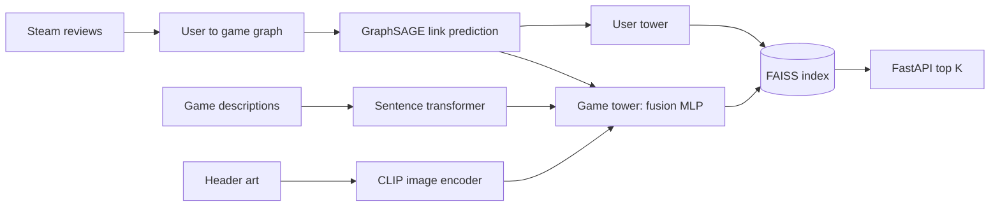

# Steam Games Recommendation Engine

[](https://github.com/Siddhesh-Ai9797/steam-recommendation-engine/actions/workflows/ci.yml)

A multimodal recommender for Steam games. A graph neural network learns who plays what, then a two tower model fuses those signals with each game's description and header art. Training scales across GPUs with PyTorch DDP, and a FAISS index serves recommendations through a FastAPI service.

## Results

| Metric | Value |
|---|---|
| GNN candidate generator, test AUC | **0.9404** |
| Fused model Recall@10 | 0.0112 on 20,000 held out pairs, about **40x** better than random |
| DDP speedup, 1 to 2 GPUs | **1.83x**, from 1,069.5s to 585.1s for 100 epochs |
| Production graph | 213,364 users, 37,015 games, 8.47M edges |

## How it works



1. **Build the graph.** Reviews from the Kaggle Steam dataset become a graph with users on one side and games on the other. Users with fewer than 50 reviews are dropped. Each edge carries whether the user recommended the game and their normalized playtime.
2. **Generate candidates.** A two layer GraphSAGE model learns user and game embeddings by predicting which edges exist, using negative sampling.
3. **Add content.** Each game also gets a sentence transformer embedding of its description and a CLIP embedding of its header art. All three vectors are normalized so no single one dominates.
4. **Fuse with two towers.** A game tower turns the three vectors into one 128 dimension embedding. A user tower projects GNN user vectors into the same space. Both train with in batch negatives and stop early on validation Recall@10.
5. **Scale.** The GNN retrains on the full graph with PyTorch DDP across two GPUs.
6. **Serve.** A FAISS inner product index over the final embeddings answers recommendation and similar game queries through FastAPI.

## What I learned

**Fusion collapsed twice before it worked.** With one negative per positive pair, the fusion model learned to give every game nearly the same vector, and three different users got 9 or 10 of the same top 10 games. Normalizing the vectors and switching to in batch negatives, where every other game in a batch counts as a negative, fixed it.

**The GNN alone leans toward popular games.** Its recommendations overlapped heavily across users. Adding text and image signals in the fusion step spread them out.

The notebook in `notebooks/` keeps the full research log, including a CLIP API change in the transformers library and Windows CUDA DLL issues, with the fix for each.

## Tech stack

| Area | Tools |
|---|---|
| Graph learning | PyTorch Geometric, GraphSAGE |
| Content | sentence-transformers, CLIP |
| Training | PyTorch, PyTorch DDP on 2 Kaggle T4 GPUs |
| Serving | FAISS, FastAPI, Docker |
| Testing | pytest, GitHub Actions |

## Project structure

```
src/steam_rec/
  data.py        Filter active users and build the graph
  models.py      GraphSAGE encoder, fusion tower, user tower, contrastive loss
  training.py    GNN and fusion training loops with early stopping
  metrics.py     Recall@K and random baseline
  index.py       FAISS index with save and load
  serve.py       FastAPI service
scripts/         Pipeline steps, run in order below
tests/           Unit and API tests on small synthetic data
notebooks/       Original Kaggle notebook and research log
```

## Running it

Download the [Game Recommendations on Steam](https://www.kaggle.com/datasets/antonkozyriev/game-recommendations-on-steam) dataset, then:

```bash
pip install --extra-index-url https://download.pytorch.org/whl/cpu -e ".[embed]"

python scripts/prepare_data.py --data-dir path/to/steam
python scripts/train_gnn.py                          # one GPU
torchrun --nproc_per_node=2 scripts/train_ddp.py     # or several GPUs
python scripts/embed_content.py --data-dir path/to/steam
python scripts/train_fusion.py                       # writes artifacts/
```

Serve the results:

```bash
uvicorn steam_rec.serve:app --reload
# or
docker build -t steam-rec . && docker run -p 8000:8000 steam-rec
```

| Endpoint | Returns |
|---|---|
| `GET /recommend/{user_node_id}?k=10` | Top K games for a user |
| `GET /similar/{app_id}?k=10` | Games most like a given game |
| `GET /health` | Index size and status |

## Tests

```bash
pip install -e ".[test]"
pytest -q
```

The 16 tests cover graph building, both models, the contrastive loss, Recall@K, the FAISS index and every API endpoint. They use small synthetic data, so they run in seconds. GitHub Actions runs them on every push.

## Author

Siddhesh Patil, MS in Artificial Intelligence, DePaul University
